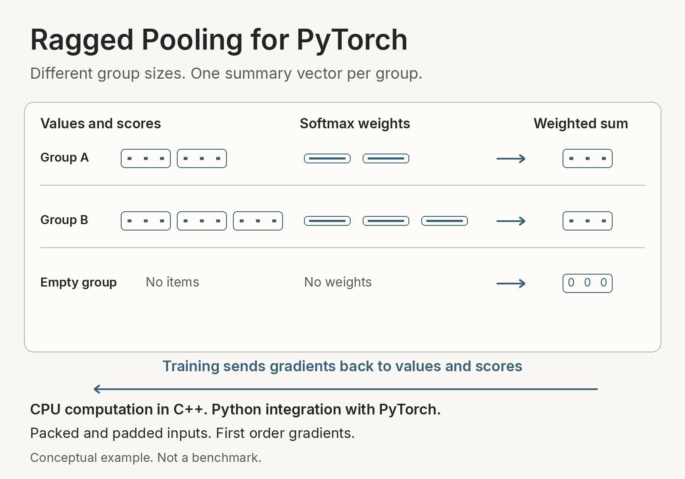

<a id="ragged-pool"></a>

# Ragged Pooling for PyTorch

Groups of feature vectors can contain different numbers of items. `ragged_pool(values, logits, offsets)` combines each group into one vector using softmax weights. C++ runs the CPU forward and backward operations. Python supplies a readable reference and connects the operation to PyTorch training.

This is a small framework integration and learning project. Ordinary PyTorch composition already expresses the operation. It does not claim a new algorithm, a production requirement or a general performance advantage.

<picture>
  <source media="(prefers-color-scheme: dark) and (max-width: 680px)" srcset="docs/ragged-pool-obscur-narrow.png">
  <source media="(max-width: 680px)" srcset="docs/ragged-pool-clair-narrow.png">
  <source media="(prefers-color-scheme: dark)" srcset="docs/ragged-pool-obscur.png">
  
</picture>

Different group sizes produce one summary vector each. This is a conceptual illustration of the CPU layer, not a benchmark. [Diagram source](docs/render_pooling_example.py).

```python
import torch
from ragged_pool import ragged_pool

values = torch.tensor([[2., 0.], [0., 4.]], requires_grad=True)
logits = torch.tensor([0., 1.0986123], requires_grad=True)
offsets = torch.tensor([0, 2, 2], dtype=torch.int64)
pooled = ragged_pool(values, logits, offsets)
# Approximately [[0.5, 3.0], [0.0, 0.0]]. The second group is empty.
pooled.sum().backward()
```

The bounded interface accepts contiguous CPU float32 or float64 values `[N,D]`, matching logits `[N]`, and contiguous int64 offsets `[B+1]`. Offsets begin at zero, end at N and are nondecreasing. Bounds are N <= 4096, B <= 128 and 1 <= D <= 128. Values and logits must be finite and within `[-1000,1000]`. Empty groups and an entirely empty batch are supported. Outputs use fresh storage. Inputs are neither changed nor moved between devices.

The native code uses maximum subtraction for stable softmax and float64 accumulation for either input dtype. It casts results back to that dtype. The reference uses ordinary PyTorch softmax and reductions, so floating point rounding can differ. See [the contract](docs/contract.md) for derivatives, numerical checks and excluded behavior.

## Pool a padded batch

`ragged_pool_padded(values, logits, mask)` accepts values `[B,T,D]`, matching logits `[B,T]` and a boolean mask `[B,T]`. True selects a real item. It packs selected entries in row order, constructs offsets and calls the same native operation. Holes and empty rows are supported. Ignored padding has exactly zero input gradients and may contain nonfinite sentinels because it is selected out before arithmetic.

This adapter requires contiguous CPU float32/float64 inputs, B <= 128, T <= 4096, 1 <= D <= 128 and **B*T <= 4096**. That last bound limits padded storage, even if few entries are selected. Selected values/logits retain the original finite `[-1000,1000]` contract. Packing allocates new tensors without changing input dtype, device or contents. The packed API remains available for larger padded envelopes.

```python
from ragged_pool import ragged_pool_padded

values = torch.tensor([[[2., 0.], [0., 4.], [99., 99.]],
                       [[99., 99.], [99., 99.], [99., 99.]]], requires_grad=True)
logits = torch.tensor([[0., 1.0986123, 99.], [99., 99., 99.]], requires_grad=True)
mask = torch.tensor([[True, True, False], [False, False, False]])
pooled = ragged_pool_padded(values, logits, mask)
# Approximately [[0.5, 3.0], [0.0, 0.0]]. Padding receives zero gradients.
pooled.sum().backward()
```

`examples/train_padded.py` supplies a seeded encoder/scorer/head consumer with two SGD updates in either dtype and comparison against the independent row reference. Add `--compiled` to compare the same model through `torch.compile(..., backend="aot_eager", fullgraph=True, dynamic=False)`, including changed masks at fixed input shapes. Opaque CPU forward/backward boundaries keep the selected count inside their implementations while reusing the packed C++ math. This establishes graph integration without an optimization or speed claim.

Clear ignored raw padding before encoder/scorer arithmetic. Masking a NaN result only at the pool can leave invalid parameter gradients upstream. Original padded values, logits and mask must stay unchanged until backward, including ignored slots. This rule for saved inputs is stricter than the earlier eager adapter's behavior of copying packed inputs. The [note on padded batches](docs/padded-batches.md) explains the boundary, debugging case, reference and installed commands. Padded export is outside this route.

## Build and run

The initial Windows target is x64, CPython 3.11.8, PyTorch 2.9.1+cpu and MSVC 19.44 with C++17. The [ordinary Linux source distribution route](docs/linux-cpu.md) uses Ubuntu 24.04 x86-64 and GCC 13 with the same Python, PyTorch and C++ standard. Each route records its own CI result. Neither promises ABI compatibility across versions or compatibility with other platforms. Building on Windows requires an existing Visual Studio C++ toolchain and Windows SDK. No CUDA toolchain is needed. Versioned package downloads belong to [this repository's releases](https://github.com/T92T1914/ragged-pool/releases); later source and CI artifacts can be newer than the published release.

From PowerShell at the checkout, create an isolated environment. Replace the example environment paths as needed. Install PyTorch from its official CPU wheel index before building. The explicit `--no-build-isolation` uses that pinned environment, and `--no-deps` prevents the package build from choosing another framework wheel.

```powershell
py -3.11 -m venv C:\work\ragged-build
$python = 'C:\work\ragged-build\Scripts\python.exe'
$env:OMP_NUM_THREADS = '1'
$env:MKL_NUM_THREADS = '1'
$env:MAX_JOBS = '2'
& $python -m pip install 'torch==2.9.1+cpu' --index-url https://download.pytorch.org/whl/cpu
& $python -m pip install -r requirements-lock.txt
$build = 'call "C:\Program Files (x86)\Microsoft Visual Studio\2022\BuildTools\VC\Auxiliary\Build\vcvars64.bat" && set DISTUTILS_USE_SDK=1 && "C:\work\ragged-build\Scripts\python.exe" -m pip wheel . --no-build-isolation --no-deps --wheel-dir dist'
cmd.exe /d /c $build
& $python -m pip install --no-deps dist\ragged_pool-0.1.0-cp311-cp311-win_amd64.whl
& $python -m pytest -q
& $python examples\train_sets.py
```

Adjust the Visual Studio path if your existing installation lives elsewhere. `vcvars64.bat` and `DISTUTILS_USE_SDK=1` apply to that child build process. They do not change the machine's global compiler settings. Native compilation is serial and the linker uses at most two code generation threads.

`examples/train_sets.py` uses explicitly synthetic groups, learned importance logits and a seeded model. It compares native and reference outputs, gradients and a real optimizer step from the same starting parameters. It demonstrates training integration. Its loss is not a model quality or accuracy result.

For an installed consumer check, create a second fresh virtual environment outside the checkout, install the same pinned dependencies and the wheel there, copy `examples/train_sets.py` to a separate directory and run it from that directory. Do not add the checkout to `PYTHONPATH`. The example reports its installed module path.

An opt-in [CPU/CUDA co-installation route](docs/coinstallation.md) builds the CPU extension against `torch==2.9.1+cu128` and gives its wheel the explicit `1cu128` build tag. It installs ordinarily beside the CUDA companion in one pinned environment. The default CPU wheel retains its exact +cpu dependency. `examples/train_backends.py` completes two matched SGD updates through CPU native, CUDA native and independent primitive routes in both dtypes, with explicit caller device placement and full gradient/parameter comparisons. This qualifies one Windows RTX 4090 environment, without expanding saved CPU artifact contracts or making a performance claim.

The [cross-device training handoff](docs/cross-device-resume.md) continues a fixed momentum-SGD run from CPU to CUDA0 or back in a fresh process. It restores weights and optimizer buffers after update two, then checks two further updates against native and independent primitive continuations. Both dtypes passed on the qualified wheel pair. Separate reset/swap momentum controls show why correct predictions alone do not establish a correct training resume.

The [two-rank Linux CPU example](docs/distributed-cpu.md) trains the packed model with unequal group counts, then a rank with no groups. It scales each local squared-error sum so DDP's averaged parameter gradients match the global group mean. Both dtypes passed global native and primitive comparisons, and a wrong-local-mean control exposes the objective error. Windows Gloo failed before training and is retained as unavailable for this consumer.

Its optional [accumulation mode](docs/distributed-accumulation.md) combines two unequal microbatches per rank before each optimizer step. Whole-window normalization preserves the group mean. Separate eager-sync and wrong-microbatch-mean routes distinguish synchronization behavior from mathematical agreement, with full-window oracles and recorded gradient-hook calls.

The [completed-window distributed handoff](docs/distributed-resume.md) continues that fixed run in fresh Linux CPU workers. Both ranks must restore weights, momentum and the progress cursor before DDP can broadcast model state. Complete continuation comparisons and reset-momentum/readiness controls check the next update. It is a controlled checkpoint handoff, with pending-gradient and crash recovery outside its scope.

The [distributed gradient clipping example](docs/distributed-clipping.md) clips the joint parameter gradient after the complete accumulation window has synchronized. An actual duplicate-replica norm control exposes over-clipping, while full native and primitive references check the optimizer inputs and momentum updates. This is a separate policy from per-example clipping, without a privacy or model-quality claim.

The [shared update admission example](docs/distributed-admission.md) makes both responsive CPU ranks agree on numerical validity before clipping or stepping. A deliberate rank 1 fault after synchronization must make both ranks refuse while preserving their completed momentum update and post-injection gradient bytes. An actual local-only control exposes different decisions and partial gradient mutation. This is cooperative refusal at one training stage, with crash recovery and malicious peers outside its scope.

## Train across packed shapes

`examples/train_dynamic.py` uses one `torch.compile(..., backend="aot_eager", fullgraph=True, dynamic=True)` model across five actual SGD updates with changing packed item/group counts. It compares outputs, raw-input and parameter gradients, and updated parameters against eager native and independent PyTorch models. Raw feature and hidden widths stay fixed. Separate pool checks qualify zero/one specialization, runtime content admission and saved-input behavior. The [dynamic training guide](docs/dynamic_training.md) explains the exact shape sequence, installed commands and the distinction between one compile API call and captured graph submissions. This adds first-order packed graph integration, without an optimized-code or speed claim.

## Resume packed training in a fresh process

An optional [CUDA companion](cuda/README.md) provides bounded first-order packed pooling through a separate distribution and dependency pin. Its Windows RTX 4090 route passed eager training and six native Compute Sanitizer runs. A separate fixed-shape `aot_eager` route now passes full-graph forward/backward integration, installed model-update comparisons and runtime admission/ownership checks. The CPU package retains its existing contract. These CUDA results do not establish optimized code generation, broader device portability or a speed advantage.

The companion also has a [trusted CUDA inference handoff](cuda/EXPORT.md). It saves a trained strict export and reloads it in a fresh installed process without the producer or original model class. The fixed default and explicit dynamic N2..32/B2..8 mode retain the native pool, with separate float32/float64 artifacts and explicit file, environment and input admission. One dynamic artifact serves independently changing item/group counts, with saved graph guards checked separately from consumer admission. The artifact still requires its native dependency and the qualified environment. This is model integration rather than a portable executable or untrusted-model sandbox.

The existing compiled consumer's `--dynamic` mode trains through a bounded [changing packed CUDA sequence](cuda/DYNAMIC.md). Item and group counts vary across five updates while the model, parameters and SGD optimizer retain their identities. Matched eager-native and independent primitive routes check complete outputs, gradients and updated parameters. This extends the model caller without a new runtime operator or kernel.

For models that already hold padded GPU batches, the companion supplies a [masked CUDA API](cuda/PADDED.md). It selects real items before arithmetic, calls the packed native operation and returns zero pools for empty rows with zero ignored gradients. Its first-order eager and fixed-shape AOT training routes retain explicit input ownership and finite storage bounds. Compaction allocates and may synchronize, without an assumed performance advantage.

The companion also has a separate [eager CUDA training resume example](cuda/RESUME.md). It saves weights and SGD momentum after update two, exits the producer, restores into a fresh CUDA0 model and optimizer, and completes the remaining three changing-shape updates. Complete native continuation records, primitive GPU comparisons and a reset-momentum control qualify one fixed trusted local trajectory. No stochastic GPU recovery, portability or security claim follows from this example.

A separate [stochastic CUDA continuation](cuda/STOCHASTIC.md) adds actual GPU dropout and shuffled batch selection to a seven-update example. It saves CUDA0's live random state and a dedicated CPU order generator/permutation/cursor after update two, exits the producer, and restores a fresh process for the remaining five updates. Native records match uninterrupted execution byte for byte, including a new permutation. Independent primitive comparisons and six omission controls expose incomplete recovery. This reuses the verified native wheel and qualifies one trusted local trajectory, with no general crash, distributed or security guarantee.

Its [functional reverse bridge](cuda/FUNCTIONAL.md) exposes selected eager first-order `torch.func.grad` and VJP calls through a separate CUDA submodule. A functional model consumer returns gradients without populating `.grad`, then deliberately supplies them to two actual SGD updates. Full native/primitive model comparisons, repeated unequal pullbacks and saved-input mutation checks qualify one pinned route. The ordinary CUDA runtime remains unchanged. Its separately qualified [bounded map route](cuda/FUNCTIONAL.md#map-three-independent-models) now supports one eager `vmap` or `vmap(grad)` layer with serial native lane calls. `cuda/examples/train_functional.py --models 3` completes two matched SGD updates in three distinct stacked models and checks shared-input sum/mean gradients against independent CUDA primitives. Per-invocation lane/item/group bounds and original contiguous admission apply. This supplies transform integration, with no parallel-kernel, speed, memory or model-quality claim. CUDA forward and higher-derivative APIs retain their separate contracts.

The [CUDA per-group clipping consumer](cuda/CLIPPING.md) uses that bridge to limit each group's complete parameter-gradient vector before averaging. Two actual SGD updates compare against ordinary-native full-batch loss-row derivatives and independent primitive GPU math. Empty groups still count and can train the prediction head's bias. This is a different optimizer input for the fixed model, with no new runtime operator, privacy guarantee or performance claim.

A separate [CUDA input-direction API](cuda/FORWARD_AD.md) adds one eager first-order JVP through a new native tangent kernel. It computes the local output change for feature and score directions, with empty/singleton behavior, explicit direction admission and metadata-only fake registration. Its installed consumer takes two matched SGD steps, then checks trained-model input sensitivity against primitive GPU forward AD, native centered differences and reverse-mode duality. A fresh wheel was built and installed for this path. New-binary sanitizer qualification remains unavailable, and no higher/map/compiled transform, security or performance result is implied.

For a loss that depends on input gradients, the separate [CUDA second-reverse API](cuda/SECOND_ORDER.md) supplies a native derivative of backward. Its nonlinear-head consumer takes two matched SGD updates with an input-gradient penalty and compares complete derivatives and updated parameters to independent GPU primitives. Returning the derivative of the incoming backward gradient preserves the head's curvature. Detached-penalty and float64 singleton controls expose missing derivative paths. This eager route has its own fresh wheel and installed checks, with no robustness, performance or new native-sanitizer claim.

`examples/resume_training.py` saves the eager packed model and SGD momentum state after two complete updates, exits the producer, then restores them in a different process for updates three through five. It compares predictions, gradients, updated parameters and momentum buffers with uninterrupted native and independent primitive PyTorch trajectories in either dtype. A model-only optimizer-reset control must diverge on continuation. The [training resume guide](docs/training_resume.md) explains the fixed checkpoint schema, cursor, installed commands and trusted-local-artifact boundary. This is one deterministic CPU recovery example, with no general RNG, distributed recovery, security or performance claim.

A separate `examples/resume_stochastic.py` continues seven eager CPU updates with actual dropout and a shuffled order of five packed batches. Its checkpoint after update two preserves the default CPU random state, a separate shuffle generator, the current permutation and next-position cursor, as well as model weights and SGD momentum. The remaining updates cross into the next permutation. Fresh-process continuation must match uninterrupted native training exactly, while reset-random-state and wrong-cursor controls expose incomplete recovery. The [stochastic resume guide](docs/stochastic-resume.md) gives the state contract, independent primitive comparisons and installed commands. This covers the declared CPU streams and local artifacts, not general stochastic replay, worker-based loading or hostile-checkpoint safety.

## Recompute activations during backward

`examples/train_checkpointed.py` runs two eager CPU SGD momentum updates with non-reentrant activation checkpointing around the encoder, dropout, scorer and native packed pool. It compares predictions, raw-input and parameter gradients, updated parameters, momentum and default CPU random-state progression with direct native execution and independent primitive pooling. A disabled-RNG-preservation control exposes incorrect stochastic recomputation, while a dropout-disabled positive control checks the wrapper separately. The [activation recomputation guide](docs/activation-checkpointing.md) explains the pure segment, explicit full-recompute policy, installed commands and saved-tensor hook accounting. Those logical save-event bytes are not unique allocations, peak process memory or a performance result. This consumer adds no package API, native kernel, compiler or CUDA contract.

## Train with an input-gradient penalty

The packed and padded eager APIs support second-order differentiation. `examples/train_gradient_penalty.py` takes two SGD steps through the packed layer using `MSE + 0.5 * mean(input_gradient**2)`, where the input gradient is constructed with `create_graph=True`. Native and independent reference models compare predictions, first input gradients, total input/parameter gradients and updated parameters in float32 and float64. This demonstrates differentiation through a gradient-dependent objective, with no model-quality, robustness or speed result.

The example includes a detached-penalty control. It has the same scalar penalty value, but its parameter gradients match MSE alone because the penalty's derivative connection has been removed. The proper penalty must change scorer and head gradients. The [packed second-order note](docs/second-order.md) explains the native derivative, a hand-calculated head gradient and installed commands.

`examples/train_padded_gradient_penalty.py` uses the padded encoder/scorer/head and normalizes its penalty by selected raw features. Moving mask holes or adding ignored padding therefore preserves the chosen objective and its two-step training trajectory. A dense-mean control shows that including ignored features in the denominator halves its penalty when padded width doubles. The [padded second-order guide](docs/padded-second-order.md) explains the objective, ownership rules, controls and installed commands. Its adapter reuses the existing native second derivative. Third derivatives and compiled double backward remain excluded. Existing packed and padded compiled training remains first-order, and saved export remains inference only.

## Train with per-example clipped gradients

`examples/train_clipped.py` computes one parameter gradient per bag using ordinary padded forward evaluation and the experimental `torch.autograd.grad(..., is_grads_batched=True)` API. It processes backward selectors in chunks, clips each example's joint parameter-gradient norm, sums in float64 and divides once by the full example count before each of two SGD steps. The default `--chunk-size 2` gives rows `[2,2,1]` for five examples. Full-batch, serial native and independent per-row PyTorch gradients check the result, including the uneven tail. Controls distinguish this update from unclipped training, clipping after the mean and equally averaging chunk means.

The [per-example gradient guide](docs/per-example-gradients.md) explains the update, chunk lifecycle, empty-bag behavior, padding invariance and installed commands for both dtypes. Within the chunk helper, selector and returned parameter-gradient blocks have at most `min(K,B)` example rows. The full forward graph and validation oracles remain, so this is not a measured process-memory reduction. This uses existing first-order autograd registrations. PyTorch's batching fallback can perform serial work, and direct `torch.func` transforms on these padded APIs remain unsupported. The example adds no noise or privacy accountant and makes no differential privacy, model-quality or speed claim.

Add `--aggregation forward-microbatches --chunk-size 2` to run a fresh forward and backward for each small group of bags. For five examples this gives forward rows `[2,2,1]`, local selector shapes `[2,2],[2,2],[1,1]` and `retain_graph=False` on every backward call. The model parameters stay fixed until the complete clipped sum is divided by five and passed to one optimizer step. Both actual steps compare against the retained-graph route and independent per-row reference.

This forward partition preserves the update for the current deterministic model because each bag's prediction and loss are independent of its peers. Batch normalization, stochastic forwards, mutable state and cross-example objectives can invalidate that argument. A hand-derived coupled-model check deliberately disagrees under splitting. The helper releases each local graph before the next forward, while full inputs, snapshots and validation oracles remain. These are graph-lifecycle and tensor-shape checks, not a measured memory or speed advantage. The existing backward-chunk route remains the default.

<a id="one-set-learning-and-cpu-cost-study"></a>

## Follow an input direction

`ragged_pool_forward_ad(values, logits, offsets)` supplies the same packed pooled result through a separate eager API with first-order forward automatic differentiation. A Jacobian-vector product (JVP) answers how the result changes when values and logits move a little along a chosen direction. Both explicit dual tensors and `torch.func.jvp` are supported on the pinned CPU environment. Ordinary reverse-mode training and its native second derivative remain available on the primal result.

The bridge reuses the first result of the existing native second-backward routine. It adds no C++ kernel or dispatcher operator. Floating tangents match their primals' shape and dtype, are finite within `[-1000,1000]`, and may use strided or expanded views. Offsets are fixed. Reversing that first-order tangent or nesting forward differentiation is excluded and rejected. The separately declared functional reverse/map and loss-HVP routes below keep their own limits. Compiled forward AD and padded JVP remain excluded.

`examples/train_forward_ad.py` compares two actual SGD updates with the original native route and independent PyTorch composition, then checks input sensitivity through the trained encoder/scorer/pool/head model. The [forward AD guide](docs/forward-ad.md) gives the hand example, derivative, installed commands and limitations. These small synthetic checks establish integration, not accuracy, robustness or speed.

## Functional model gradients

The same packed bridge also supports eager `torch.func.grad`, `vjp`, and one bounded `vmap` or `vmap(grad)` composition. A separate public Function boundary around native backward lets functional reverse transforms reach the existing C++ derivatives. Explicit manual batching rules run native lanes serially. There is no new kernel or batching speed claim.

Mapped values/logits/offsets have a common packed shape envelope. Each selected primal lane retains original contiguous CPU admission. Each batching-rule invocation admits at most eight lanes, with aggregate `K*N <= 4096` and `K*B <= 128`, including shared arguments. PyTorch's `chunk_size` can run a larger outer map through several bounded invocations, so these limits do not cap the caller's total work or process memory. Nested maps are rejected through an identity guard that preserves strides. These are complete packed problems or model replicas, not arbitrary per-bag ragged maps.

`examples/train_functional_models.py` uses stacked leaf parameter dictionaries, `functional_call` and `vmap(grad)` to take two real SGD updates in three distinct models. Each model is checked against serial original-native and independent PyTorch execution. Shared-input sum and mean gradients use unequal lane contributions. The [functional training guide](docs/functional-models.md) explains representation, admission, reduction, installed commands and excluded compositions.

## Inspect loss curvature in one direction

The packed bridge also supports one eager `torch.func.jvp(torch.func.grad(scalar_loss))` composition. This returns a Hessian-vector product: how the loss gradient changes along a supplied direction, without constructing a full Hessian matrix. Native backward's tangent includes changes to both the pool inputs and its output cotangent. Omitting the latter loses part of a nonlinear loss's curvature.

`examples/train_curvature.py` takes two matched SGD steps through the bridge, original native API and independent PyTorch model. It then holds the trained parameters and packed inputs fixed and checks parameter-dictionary HVPs for two directions against native reverse-over-reverse, independent tensor math and centered differences of gradients. The consumer checks direction linearity and bilinear symmetry. Separate pool-boundary mathematical tests retain the omitted-cotangent control. The [HVP guide](docs/hessian-vector-products.md) gives an analytic singleton example, admission, installed commands and the higher-derivative boundary. This is numerical and framework integration evidence, with no optimizer improvement, accuracy, robustness, speed or process-memory claim. Further HVP differentiation, mapped HVPs, full Hessian helpers, padded transforms and compiled/exported transforms remain excluded.

## Solve one fixed curvature system

`examples/solve_curvature.py` consumes the packed HVP in a bounded detached conjugate-gradient solve, `(H + lambda I)s = -g`, at fixed trained parameters. It reuses two ordinary matched SGD updates, then compares the complete solve with native reverse-over-reverse and independent primitive PyTorch routes. The returned solution is never applied to the model.

The example-local helper has explicit input, iteration and product bounds, refuses nonpositive or unresolved curvature, and recomputes a true residual before declaring convergence. Positive damping alone does not establish positive definiteness. An omitted-H control must fail the independent intended-system residual gate. The [damped solve guide](docs/damped-curvature-solve.md) explains the analytic SPD case, refusal controls, installed commands and fixed policies. This adds a numerical consumer without another transform or optimizer, with no speed, memory, training-improvement, accuracy or security claim.

## One synthetic training study and CPU cost comparison

`examples/learn_sets.py` trains a small synthetic classifier for bags with native attention, reference attention, mean, max and sum pooling. It uses one fixed task, three paired initialization seeds, held out sets with lengths inside the training range and longer bags, and checkpoint selection using only validation. Attention adds 16 scorer parameters to the common encoder/head with 97 parameters. In the recorded run, attention had the lowest mean binary cross entropy (BCE) in both test sets. Accuracy on longer bags fell to 73.31%, below max pooling's 75.78%. These are descriptive synthetic results, with no real world accuracy claim.

The accompanying `examples/cpu_cost.py` compares complete checked calls against the readable reference and an equivalent segmented PyTorch composition. Native had lower medians in the eight declared cases on the executed Windows environment with one thread, with substantial variation on the shared machine. The native kernel was retained after the investigation. See the [fixed protocol, every model variant, timings, compiler outcome and reproduction commands](docs/cpu-study.md) and the [results in machine readable form](docs/results/cpu-study.json).

For installed execution, copy `learn_sets.py`, `pool_baselines.py` and `cpu_cost.py` together outside the checkout after installing the ordinary wheel into a fresh isolated environment. Use the revision and wheel you actually built, and a new receipt path for each run.

```powershell
$python = 'C:\work\ragged-accept\Scripts\python.exe'
$consumer = 'C:\work\ragged-consumer'
$wheel = 'C:\work\ragged-pool\dist\ragged_pool-0.1.0-cp311-cp311-win_amd64.whl'
$revision = git -C C:\work\ragged-pool rev-parse HEAD
& $python -I "$consumer\learn_sets.py" --output "$consumer\study.json" --source-revision $revision --wheel $wheel
& $python -I "$consumer\cpu_cost.py" --timing --output "$consumer\timing.json" --source-revision $revision --wheel $wheel --budget-seconds 300
```

The study freezes data and training choices before held out evaluation, records content digests and class/length histograms, checks native/reference gradients and an Adam update before training, and retains all selected seeds. Its optional `--smoke` mode performs 20 native/reference updates on training and validation only. It supplies a small CI check, distinct from both the full study and the original consumer with a single step.

## Export the trained consumer

`examples/export_sets.py` trains the native classifier with the existing protocol for training and validation with seed 11, saves its selected tensor state dictionary, checks restricted checkpoint reload and exports one inference graph. `examples/predict_sets.py` loads that trusted artifact in a fresh process using the installed package, without importing the training script or rebuilding its model class. The graph retains the native pooling operation.

This exported example has fixed float32 inputs with four features and dynamic `0 <= N <= 4096`, `2 <= B <= 128`. A constraint from strict export excludes zero and one group from this route. Empty groups within the declared range are included. The eager pooling API retains its broader contract. See the [artifact contract and executed evidence](docs/exported-consumer.md) for the exact route, limitations and loading boundary.

After copying the examples together outside the checkout, use new artifact and receipt paths. The producer's receipt supplies the expected manifest digest to the separate consumer process.

```powershell
& $python -I "$consumer\export_sets.py" --directory "$consumer\trained-model" --output "$consumer\export-producer.json" --source-revision $revision --wheel $wheel
$exportReceipt = Get-Content -LiteralPath "$consumer\export-producer.json" -Raw | ConvertFrom-Json
& $python -I "$consumer\predict_sets.py" --directory "$consumer\trained-model" --manifest-sha256 $exportReceipt.artifact.manifest_sha256 --output "$consumer\export-consumer.json"
```

Load only trusted model artifacts. The consumer checks byte identities before graph loading, but a SHA256 digest does not authenticate a publisher and `torch.export.load` is not a sandbox. The separate `weights_only=True` checkpoint reload does not make arbitrary exported graphs safe to load. No artifact compatibility across versions or standalone binary is promised.

## Export a trained padded model

`examples/export_padded.py` trains the padded encoder/scorer/head for two SGD steps in float32 or float64 and strictly exports the updated model. `examples/predict_padded.py` consumes the saved graph in a separate process without importing the producer or original model class. It compares predictions and pooled vectors with independent per-row PyTorch math using the admitted saved weights. Both programs use the installed native package.

This example accepts raw `[B,T,3]` features and a bool mask, with `B=2..32` and `T=2..128`. Selected raw features are finite and within `[-6,6]`; ignored NaN/Inf padding is cleared before encoder arithmetic. Shape corners, changed masks, empty rows and the same items under extra padding or moved holes check that serialized behavior remains correct. Explicit consumer admission is separate from the exported graph's guards. See the [padded artifact contract and commands](docs/padded-export.md) for the owned-file trust boundary, size-one guard debugging case and exact limits. Two updates demonstrate integration, with no model-quality, robustness or speed claim.

## What the checks mean

`tests/test_math.py` compares the native result and both input gradients with independently differentiated PyTorch composition and checks float64 finite differences. Contract checks cover malformed inputs, empty and singleton groups, storage, version rules and upstream gradient views. Registration checks use `torch.library.opcheck` separately from the mathematical tests.

The concrete-shape compiler acceptance path uses `torch.compile(..., backend="aot_eager", fullgraph=True, dynamic=False)` for forward and backward, including the padded training consumer. The separate packed dynamic-training route uses `dynamic=True` across its declared changing-N/B sequence. Both exercise graph capture and autograd integration. The separate CPU study also executed native Inductor forward/backward on one declared packed case in the pinned environment. Its equivalent attempt using built in operations failed during compilation of generated code, and no optimized speed advantage was established. Fake tensor implementations describe each forward and private backward output without reading tensor contents. Runtime execution still validates selected numerical contents and packed offsets.

Initial build and acceptance results are recorded in [the local acceptance note](docs/acceptance.md). The later [CPU study](docs/cpu-study.md) records its own source, installed wheel and bounded measurements. The packed and padded eager second-order routes have their own [native derivative](docs/second-order.md) and [padded caller checks](docs/padded-second-order.md). Devices beyond CPU, float16/bfloat16, sparse inputs, arbitrary forward layouts, mixed precision, third derivatives and general `torch.func`/vmap transforms are outside the CPU package's contract. The separate CUDA companion has the narrower scope described above. The bounded per-example caller uses the separate experimental batched-backward route described above.

The [Windows CPU workflow](.github/workflows/cpu.yml) rebuilds the wheel, installs it into a fresh environment outside the checkout, checks package and license bytes, runs the test suite, and executes both dtype consumers with one step plus the study smoke using only validation. The actual run and revision determine CI status. A workflow file by itself is not an executed result.

The [ordinary Linux workflow](.github/workflows/linux-cpu.yml) first checks the source distribution against the source and builds its optimized wheel from that archive outside the checkout. A separate environment runs installed checks, both examples with an optimizer step, the study smoke and the full trained export round trip. It records compiler/runtime facts and the identities of its archive, wheel and loaded libraries. Its plain `linux_x86_64` wheel tag is limited to the tested environment; it is not a manylinux compatibility claim or a bitwise reproducible build result.

[Native boundary checks](docs/native-robustness.md) describe generated mathematical/admission cases, a layout bug involving a combined negative view, and a separate Linux AddressSanitizer workflow. Generated second-order checks qualify the accepted packed/padded eager derivative paths with independent reference math, relations, directional differences and a sensitive omitted-`dg` control. Fixed seeds establish the declared categories, while a separate short timed campaign adds repeated cases. The workflow instruments the production extension and checks its loaded identity. It supplies bounded evidence from memory diagnostics when executed successfully, with prebuilt framework and limits of leak detection stated explicitly. Ordinary Windows wheel acceptance remains separate.

## License and attribution

Project source is licensed under [MIT](LICENSE). [NOTICE](NOTICE) records implementation assistance, upstream guidance and the separate PyTorch dependency license. The full PyTorch v2.9.1 main notice is retained with the wheel and source distribution. No PyTorch dependency binaries are bundled.

T set the project scope and acceptance requirements. The implementation, test authoring, source review and local command execution in this initial version used Codex assistance. The execution record establishes component behavior, not unaided expertise.
